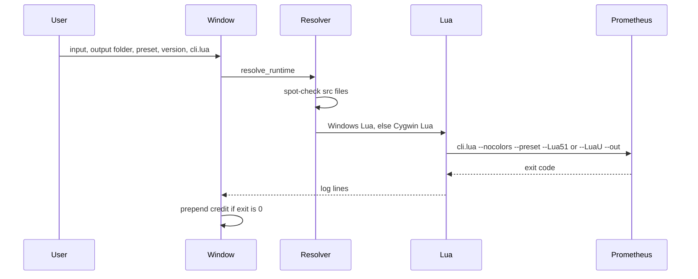

# Core Flows

> These flows are inferred from code and from upstream Prometheus master. Ask the user to confirm if they match the product.

## Flow list

| Priority | Flow | Entry point | Evidence |
| --- | --- | --- | --- |
| P0 | Obfuscate one file | `Launcher.run` | `prometheus_launcher.py` |
| P0 | Refuse a bad checkout | `cli_checkout_error` | `CHECKOUT_FILES` |
| P1 | Diagnose paths | `py -3 prometheus_launcher.py --check` | `write_check` |

## Flow: obfuscate one file

### Call chain

1. `prometheus_launcher.py:Launcher.run`
2. `prometheus_launcher.py:resolve_runtime`
3. `prometheus_launcher.py:build_invocation`
4. `prometheus_launcher.py:run_prometheus`
5. `prometheus_launcher.py:prepend_credit` on exit 0

### Key branches

- Presets offered by the window: Minify, Weak, Medium, Strong. Upstream `src/presets.lua` also defines Cff and Vmify. This launcher does not offer those two.
- Version argument is `--Lua51` or `--LuaU`.
- Output name is `<input-stem>.obfuscate.lua` in the chosen folder.
- Cygwin invocation uses `bash -lc` and `/cygdrive/...` paths. Windows Lua gets native paths.
- Success and failure use a sound and a three-second popup.

## Flow: what must exist in the Prometheus checkout

Root `cli.lua` is not enough. The full upstream repository is not required.

Upstream master `cli.lua` only sets `package.path` and `require("src.cli")`. `src/cli.lua` then `require("prometheus")`, which is `src/prometheus.lua`. That loads `src/presets.lua` and `src/prometheus/pipeline.lua`. The pipeline loads the parser, steps, name generators, and unparser. `src/prometheus/steps.lua` loads every step at startup, including Cff and Vmify, so `src/prometheus/cff/` and `src/prometheus/vm/` are loaded even for Minify.

The launcher spot-checks only:

- `src/cli.lua`
- `src/prometheus.lua`
- `src/prometheus/pipeline.lua`

Those three files beside the selected root `cli.lua` are the acceptance gate. Keep the whole `src/` tree or Lua fails after the gate. Do not select `src/cli.lua`.

Not required to obfuscate: `doc/`, `tests/`, `web/`, `benchmarks/`, `assets/`, `scripts/`, Docker, `install.sh`, the packaged `prometheus-lua` binary, or the Node playground files.

### Call chain

1. upstream `cli.lua` `require("src.cli")`
2. upstream `src/cli.lua` `require("prometheus")`
3. upstream `src/prometheus.lua` `require("prometheus.pipeline")` and `require("presets")`
4. upstream `src/prometheus/pipeline.lua` `require("prometheus.steps")`
