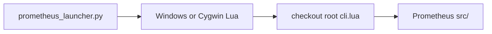

# Project Structure

## Directory tree

```text
prometheuslauncher/
├── prometheus_launcher.py      # source entrypoint and GUI
├── PrometheusLauncher.spec     # PyInstaller spec for the windowed .exe
├── requirements.txt            # no runtime packages; build note only
├── .env.example                # empty path overrides
├── .gitignore                  # ignores build/, dist/, local config
├── README.md
├── SECURITY.md
├── AI_README.md
└── docs/ai-readme/
```

`build/` and `dist/` are PyInstaller output. They are gitignored. `dist/PrometheusLauncher.exe` is the windowed executable for a later GitHub Release. Do not commit it.

Prometheus itself is not in this tree. The user points the launcher at a separate checkout.

## Module responsibilities

| Path | Responsibility | Key files |
| --- | --- | --- |
| `prometheus_launcher.py` | GUI, path discovery, checkout spot check, process launch, credit header | `Launcher`, `resolve_runtime`, `cli_checkout_error` |
| `PrometheusLauncher.spec` | One-file windowed build of `prometheus_launcher.py` | `Analysis`, `EXE` |
| `.env.example` | Names of the three path overrides, empty values | `PROMETHEUS_LAUNCHER_CLI`, `PROMETHEUS_LAUNCHER_LUA`, `PROMETHEUS_LAUNCHER_BASH` |

## Dependencies between modules



## Evidence

- `prometheus_launcher.py`
- `PrometheusLauncher.spec`
- `.gitignore`
- `.env.example`
