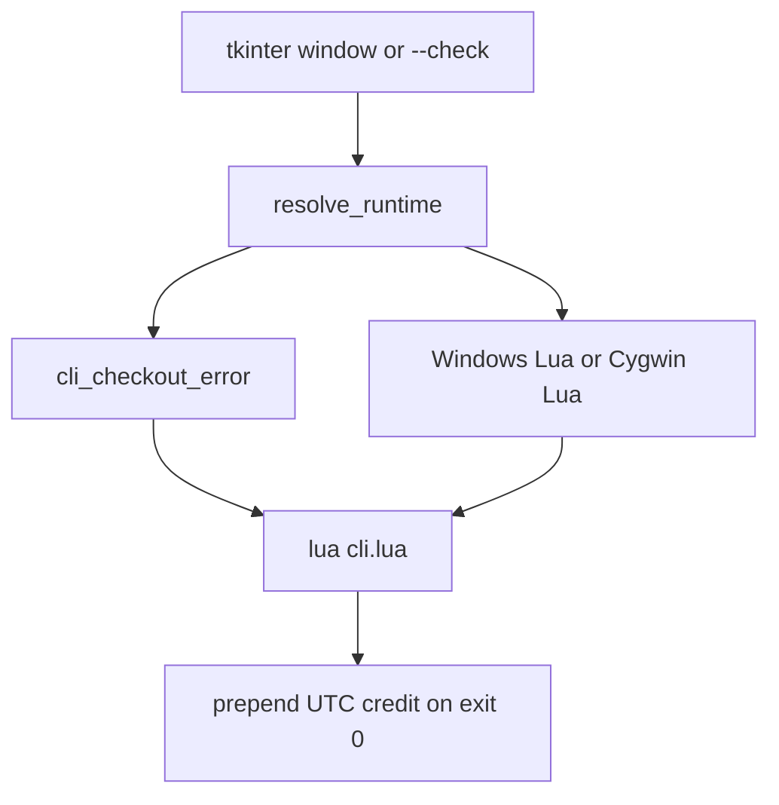

# Technical Architecture

## Architecture overview

## Layers

| Layer | Responsibility | Main files/classes |
| --- | --- | --- |
| Interface | Window, file pickers, `--check` text report | `Launcher`, `write_check` |
| Resolution | Env, then config, then discovery for Lua and Cygwin bash | `configured_paths`, `resolve_runtime`, `discover_cygwin_bash`, `discover_windows_lua` |
| Checkout gate | Accept only a root whose spot-check files exist | `cli_root`, `cli_checkout_error`, `CHECKOUT_FILES` |
| Run | Hidden subprocess, log lines, credit header, popup | `build_invocation`, `run_prometheus` |

## Technology stack

| Category | Technology | Version/source | Purpose |
| --- | --- | --- | --- |
| Language/runtime | Python | 3.10 or newer in code (`str \| None`); script run verified on 3.13.4 | GUI and process control |
| UI | tkinter | stdlib, official Windows installer | Window |
| Build tool | PyInstaller | not pinned; 6.22.3 produced the current exe | Windowed one-file executable |
| Runtime packages | none | `requirements.txt` | Script uses the standard library |
| Test framework | none | no test directory | Manual `--check` and helper calls |

## Path rules

Cygwin bash and Lua are discovered or set by the user. Prometheus `cli.lua` is never discovered.

Discovery for bash, in order: `CYGWIN_HOME`, `CYGWIN_ROOT`, the Cygwin setup registry `rootdir`, well-known install folders, then `PATH`. A candidate counts only when `bash.exe` sits beside `cygwin1.dll`. Git Bash is rejected. No single drive letter is required.

Config file: `%APPDATA%\PrometheusLauncher\config.json`. Keys used for tools: `prometheus_cli`, `lua_bin`, `cygwin_bash`. The window also stores `input_file` and `output_folder`.

## Evidence

- `prometheus_launcher.py`
- `requirements.txt`
- `PrometheusLauncher.spec`
